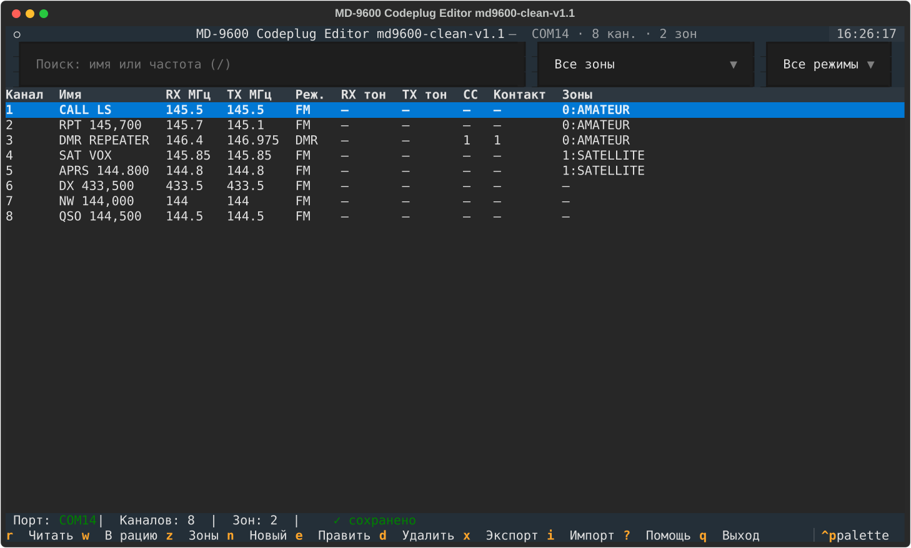
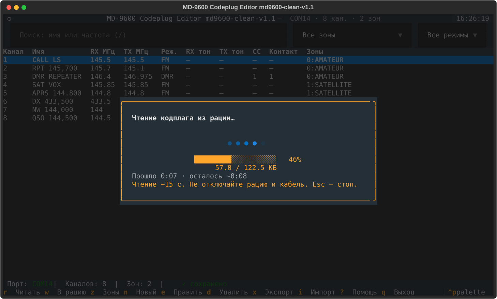
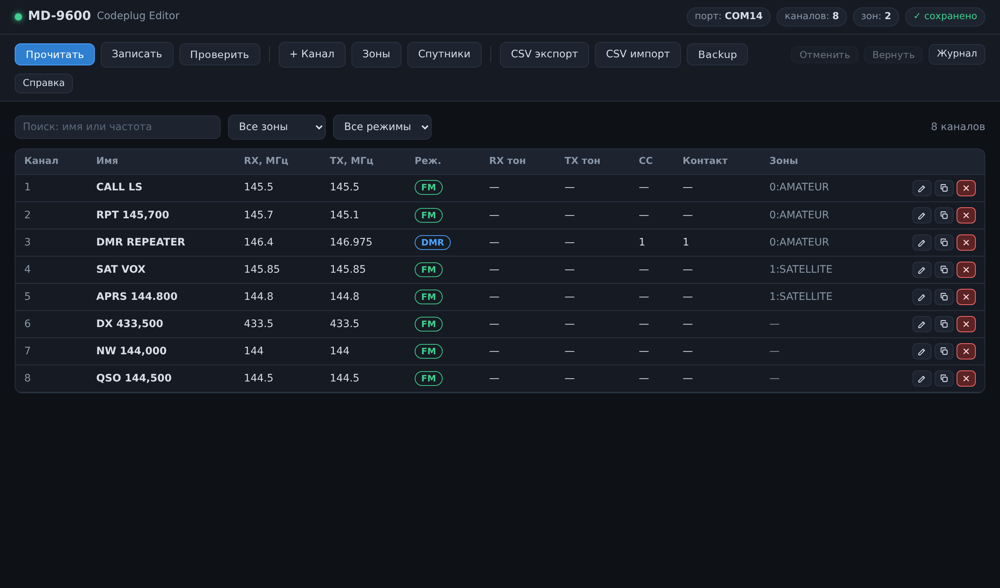
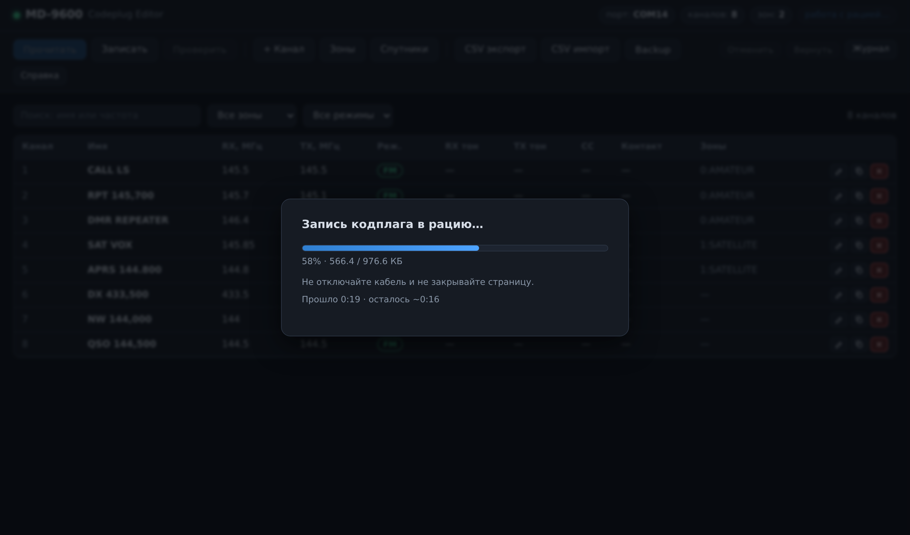
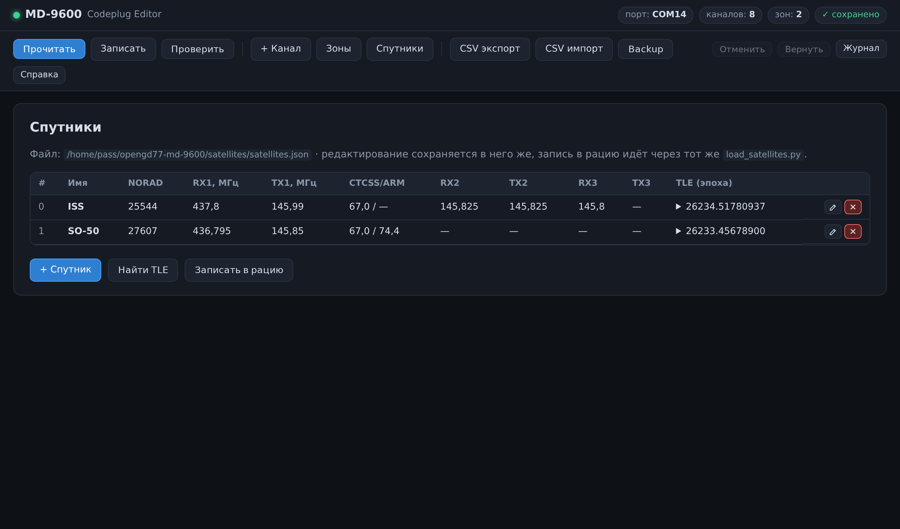
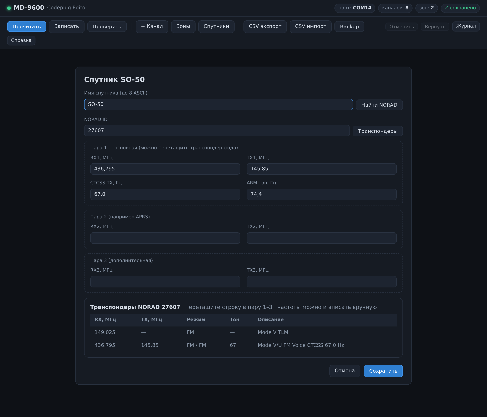

# MD-9600 Codeplug Editor (OpenGD77)

TUI- и WEB-редакторы кодплага для раций **TYT MD-9600** с
прошивкой [OpenGD77](https://github.com/open-ham/OpenGD77). Работают с рацией
напрямую по USB: чтение, правка каналов и зон, запись, CSV, спутниковые TLE.

Главный экран и окно чтения с прогрессом:




Снимки генерируются скриптами: `python docs/make_screenshot.py` (TUI)
и `python docs/make_webui_screenshot.py` (WEB UI, нужен playwright из
`requirements-dev.txt`).

## Возможности

- Чтение и запись кодплага с прогрессом и ETA; чтение отменяется по `Esc`.
- Автоматический backup при чтении и перед записью, с меткой времени.
- Редактор каналов с валидацией частот, тонов, color code и контактов.
- Экран зон: состав, переименование, создание, удаление.
- Поиск по имени/частоте, фильтры по зоне и режиму, undo/redo правок.
- Импорт и экспорт CSV с предпросмотром и ошибками по номерам строк.
- Проверка записи: `v` читает рацию обратно и сравнивает с буфером.
- Спутниковые TLE: `satellites/satellites.json`, поиск актуальных TLE по
  каталогу satgs.ru и запись блока в рацию (`satellites/load_satellites.py`
  или кнопка «Спутники» в WEB UI).
- Отдельный загрузчик спутниковых TLE (`satellites/load_satellites.py`).
- Журнал событий `[l]`, справка `[?]`, лог `md9600_debug.log`.

## Требования

- Python 3.10\+ и [Textual](https://textual.textualize.io/), pyserial
  (ставятся из `requirements.txt`).
- Рация с прошитым OpenGD77 и USB-кабель.
- Права на последовательный порт: в Linux — группа `dialout`, в Windows — порт
  не должен быть занят официальной CPS или терминалом.

## Установка

```bash
# Linux / macOS
python3 -m venv venv
venv/bin/pip install -r requirements.txt

# Windows (PowerShell)
py -3 -m venv .venv
.venv\Scripts\pip install -r requirements.txt
```

Библиотека `opengd77` вендорена в `vendor/`, ставить её отдельно не нужно.

## Запуск

```bash
venv/bin/python src/md9600_tui.py              # порт определяется сам
venv/bin/python src/md9600_tui.py --port COM14 # или указать явно
```

```powershell
.venv\Scripts\python.exe src\md9600_tui.py
.venv\Scripts\python.exe src\md9600_tui.py --port COM14
```

Порт ищется по USB VID:PID `1FC9:0094` (OpenGD77), затем по описанию
(`opengd77`, `md-9600`, `virtual com`), затем берётся единственный USB-порт.
Если кандидатов несколько, программа не угадывает: она перечисляет порты и
просит `--port`.

Рабочий цикл: **`r`** прочитать → править каналы и зоны → **`w`** записать
(подтверждение словом `WRITE`) → **`v`** проверить, что в рации лежат именно
эти данные.

## Горячие клавиши


|Клавиша|Действие|
|:---|:---|
|`r`|читать кодплаг из рации (backup `codeplug_backup_*.g77`)|
|`w`|записать кодплаг в рацию — подтверждение словом `WRITE`|
|`v`|проверить запись: прочитать рацию и сравнить с буфером|
|`z`|зоны: состав, переименование, создание, удаление|
|`n` / `e` / `Enter`|новый канал / редактировать / применить в диалоге|
|`d`|удалить канал (слот \+ enable-бит \+ зоны), с подтверждением|
|`c`|дублировать канал|
|`Ctrl+Z` / `Ctrl+Y`|отменить / вернуть правку|
|`x` / `i`|экспорт CSV / импорт CSV с предпросмотром|
|`b`|резервная копия текущего буфера|
|`/`|поиск по имени, частоте или зоне|
|`Esc`|сбросить фильтры, закрыть диалог, прервать чтение или проверку|
|`↑` `↓` `PgUp` `PgDn` `Home` `End`|прокрутка справки и журнала (и колесо мыши)|
|`l`|журнал событий|
|`?` / `F1`|справка|
|`q`|выход (с защитой несохранённых изменений)|

## WEB UI

Тот же функционал, что у TUI, но в браузере (Django). Скрипты лежат
отдельно в `webui/` и работают поверх тех же модулей `src/` без их
доработки: чтение/запись/проверка с прогрессом и отменой, редактор
каналов и зон, undo/redo, поиск, CSV с предпросмотром, backup, журнал.
Страница «Спутники» работает со списком из
`satellites/satellites.json`: редактирование (добавить/изменить/удалить
с сохранением в тот же JSON), NORAD ID ищется по имени в каталоге
`satgs.ru/satonline.txt`, там же берутся TLE («Найти TLE»). В карточке
спутника подгружаются транспондеры с `satgs.ru/transmitters.zip` —
строку можно перетащить мышкой в пару частот 1–3 (тоже с тоном), поля
остаются редактируемыми для ручного ввода. Запись блока — через тот же
`satellites/load_satellites.py`.

Главный экран, прогресс записи и спутники:






```bash
venv/bin/pip install -r requirements-web.txt
venv/bin/python webui/run.py                    # http://127.0.0.1:8000/
venv/bin/python webui/run.py --port COM14 --addr 127.0.0.1:9000
venv/bin/python webui/run.py --public           # слушать 0.0.0.0 — доступ из LAN
```

Без `--public` интерфейс доступен только с локальной машины. С
`--public` — с других хостов (проверьте firewall), но помните: это
dev-сервер Django без авторизации — только в доверенной сети.

Порт последовательный: не запускайте TUI и WEB UI одновременно.
Задачи к рации сериализуются очередью внутри WEB UI, прогресс
опрашивается из браузера каждые ~0.6 с.

## Как это работает

Рация отдаёт память командой `R` кусками не больше 32 байт, а FLASH-сектор
(4 КБ) при записи нужно сначала прочитать, изменить и записать целиком.
Поэтому в `src/gd77_flash.py` лежит собственный читатель `read_codeplug_safe()`:
выбор скорости (115200 с откатом на 9600), повторы, защита от нулевого ответа,
прогресс и отмена. Полный кодплаг читается примерно за 15 секунд. Прогресс
записи считается по секторам: `radio.write_codeplug(cp, progress=fn)`
докладывает о каждом прошитом или пропущенном секторе — полоса с ETA есть и
при `w`.

Подробнее — в документах:

- [docs/radio.md](docs/radio.md) — чтение и запись, скорость, диагностика,
  автоопределение порта.
- [docs/format.md](docs/format.md) — формат кодплага: банки каналов, enable-биты,
  зоны, частоты BCD, карта памяти.
- [docs/satellites.md](docs/satellites.md) — спутниковые каналы и `satellites.json`.

## Важно

- Не отключайте рацию и кабель во время **записи** — прервать её нельзя.
- При долгом чтении или молчании рации жмите `Esc`, а не выключайте питание:
  отмена освобождает порт и закрывает экран CPS.
- Старые копии не затираются: `codeplug_backup_*.g77` при чтении и
  `codeplug_before_write_*.g77` перед записью.
- Диагностика всегда в `md9600_debug.log`, события — в журнале `[l]`.

## Структура

```
src/md9600_tui.py    TUI-приложение (точка входа)
src/gd77_flash.py    протокол чтения/записи и безопасный читатель
src/gd77_patch.py    патчи библиотеки opengd77 (BlockView, зоны, parts)
src/gd77_zones.py    операции над зонами через raw-байты
src/cp_utils.py      валидация каналов, тоны, enable-биты
satellites/          загрузчик спутниковых TLE и satellites.json
vendor/opengd77/     вендореная библиотека opengd77xfer (GPLv3)
webui/               WEB UI на Django (run.py — точка входа)
docs/                скриншоты и подробная документация
tests/               тесты (рация не нужна)
```

## Тесты

```bash
venv/bin/pip install -r requirements-dev.txt   # pytest, ruff и playwright
venv/bin/python -m pytest tests -q
```

```powershell
.venv\Scripts\pip install -r requirements-dev.txt
.venv\Scripts\python.exe -m pytest tests -q
```

Тесты используют синтетический кодплаг и фейковый порт: покрыты валидация
полей, enable-биты, raw-операции зон, безопасное чтение (короткие ответы,
нулевая длина, выбор скорости, отмена), сценарии TUI и WEB UI
(Django test client: каналы, зоны, CSV, undo/redo). Рация не нужна.

## Лицензия

`vendor/opengd77` — GPLv3 (см. `vendor/LICENSE`): © Kiril Zyapkov и
контрибьюторы [opengd77xfer](https://github.com/kzyapkov/opengd77xfer).
Протокол, формат памяти и строки USB VID:PID — проект
[OpenGD77](https://github.com/open-ham/OpenGD77). Код редактора — производная
работа на основе GPLv3-библиотеки.